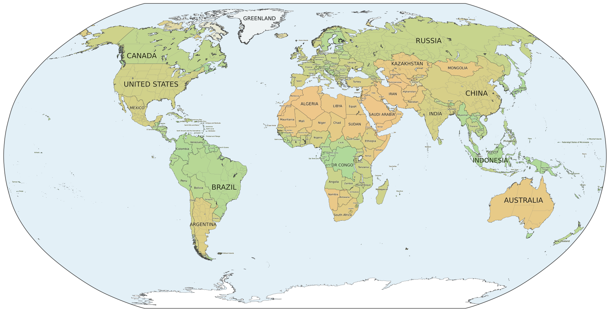
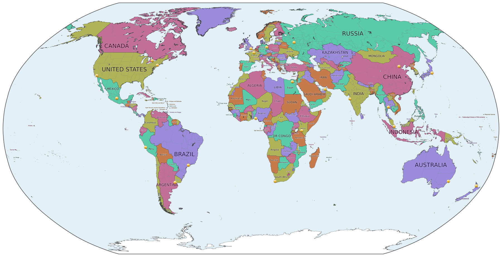

# worldmap

Renders a poster-sized political world map: a 7200 x 3693 px RGBA PNG (36 in wide at 200 dpi) in the Robinson
projection, with country borders, state/province borders for the largest countries, and non-overlapping country labels.
It can also draw pins (golden spheres) at a list of locations, e.g. to digitise a pin-your-hometown poster.

## Install

```
git clone https://github.com/JamesMcClung/worldmap
cd worldmap
python3 -m venv .venv
source .venv/bin/activate
pip install -e .
```

Install with `-e` (editable): map data is downloaded into the repo's `.cache/` directory on first use.

## Use

```
make_map                      # writes worldmap.png
make_map out.png              # choose the output file
make_map --earth              # natural colours (sand to green) from Natural Earth land-cover imagery
make_map --pick pins.txt      # click on the rendered map to add pins to pins.txt
make_map --pins pins.txt      # draw the pins; writes worldmap_pins.png
```

| Option | Effect |
| --- | --- |
| `--earth` | Colour each region by what it looks like from space instead of distinct political colours. The first run downloads a ~75 MB raster. |
| `--pins FILE` | Draw pins from `FILE`, one `lon,lat` per line (`#` starts a comment). |
| `--pin-size IN` | Pin diameter in inches on the 36 in poster (default 0.24). |
| `--dpi DPI` | Output dots per inch on the 36 in poster (default 200, i.e. 7200 px wide). The layout is the same at any resolution; e.g. `--dpi 50` makes an 1800 px preview. |
| `--pick FILE` | Open the already-rendered map in a window. Left-click adds a pin, right-click or `u` undoes it, and closing the window appends the new pins to `FILE`. |
| `--recolor` | Recompute the country colouring instead of using the cached one. |

A run takes about 10 s once the data is downloaded. Output goes to the current directory.

## Examples

The images in [`examples/`](examples) are rendered at `--dpi 50` (1800 px wide); the default is 200 dpi (7200 px).

Political colours (the default):

```
make_map examples/political.png --dpi 50
```


Natural colours with `--earth`:

```
make_map examples/earth.png --earth --dpi 50
```



Pins from [`examples/pins.txt`](examples/pins.txt), a list of 23 large cities:

```
make_map examples/pins.png --pins examples/pins.txt --dpi 50
```



A pin file has one `lon,lat` per line, and `#` starts a comment:

```
-74.0060,40.7128    # New York
-0.1276,51.5072     # London
139.6503,35.6762    # Tokyo
```

## Development

```
pip install -e '.[dev]'
pytest           # ~25 s: unit tests plus pixel-exact renders of the default, --earth and --pins maps
mypy src
```

The render tests compare against `tests/fingerprints.json`. They are skipped if your library versions differ from the
recorded ones. After a deliberate change to the map, re-record with `UPDATE_REFERENCE=1 pytest` and commit the file.

## Data

[Natural Earth](https://www.naturalearthdata.com/) 10m cultural vectors and the Natural Earth I land-cover raster,
both public domain. They are downloaded on first use from naciscdn.org into `.cache/`, which also holds the colouring
caches. Delete `.cache/` to start fresh.

## License

MIT; see [LICENSE](LICENSE).
