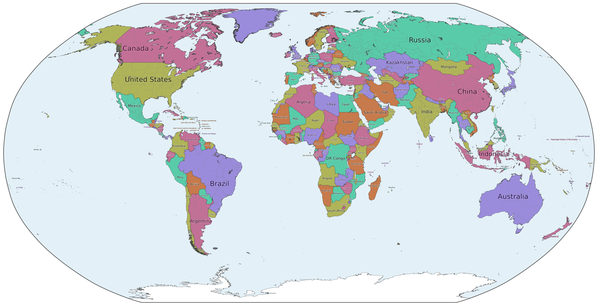
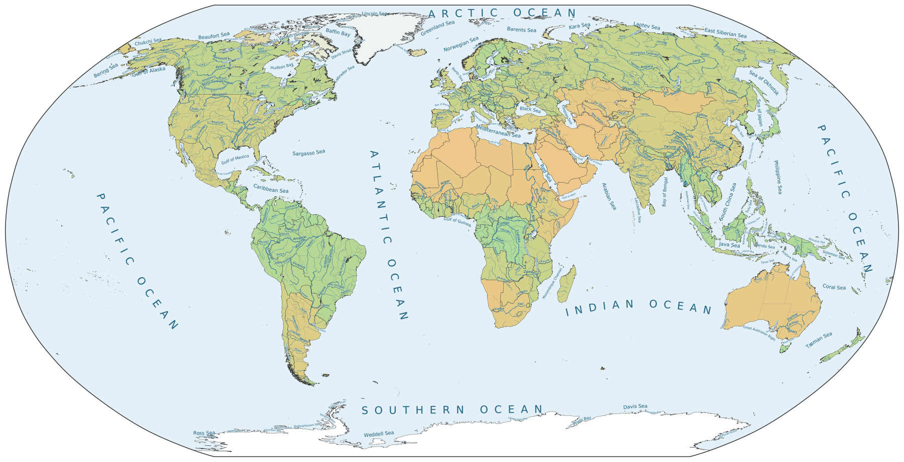
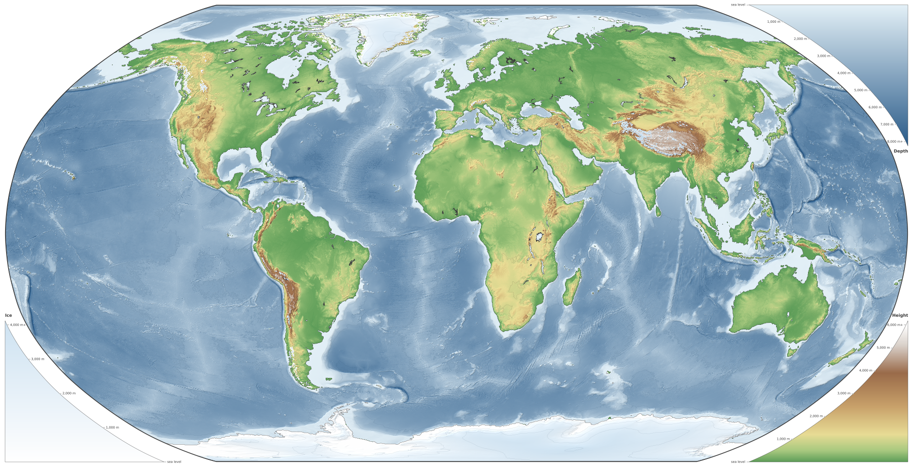
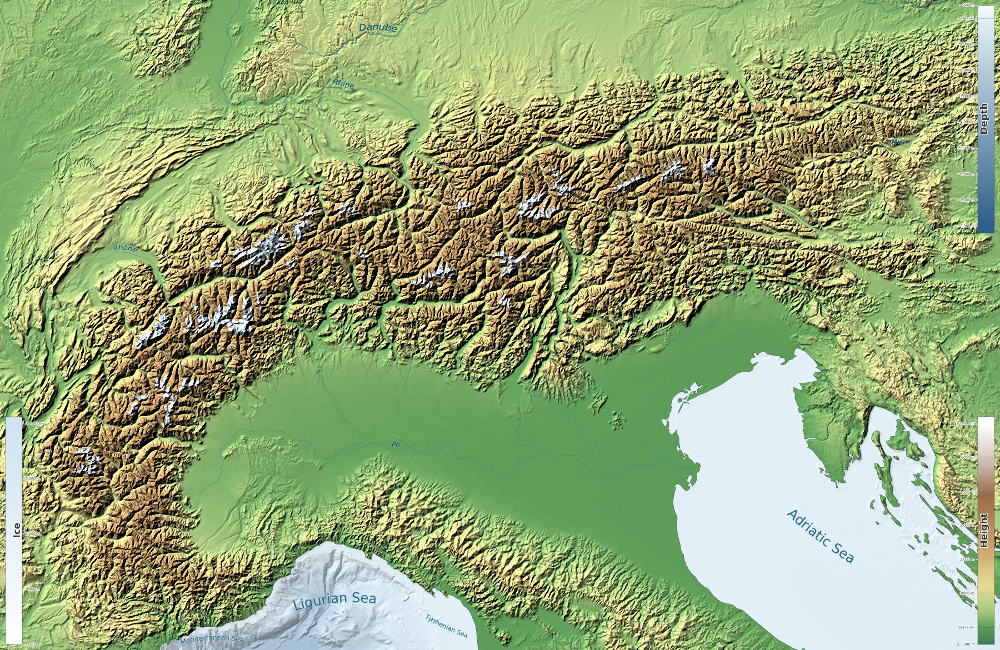

# worldmap

Renders a poster-sized political world map: a 7200 x 3693 px RGBA PNG (36 in wide at 200 dpi) in the Robinson
projection, with country borders, state/province borders for the largest countries, and non-overlapping country labels.
It can also draw a topographic map instead (heights, hill shading and contours, optionally the sea floor), zoom in on
any region (a country, an ocean, a box or a point and a size), and draw pins (golden spheres) at a list of locations,
e.g. to digitise a pin-your-hometown poster.

## Install

```
git clone https://github.com/JamesMcClung/worldmap
cd worldmap
python3 -m venv .venv
source .venv/bin/activate
pip install -e .
```

Install with `-e` (editable): map data is downloaded into the repo's `.cache/` directory on first use. Before
downloading, `make_map` says what it needs, how big it is and where it goes, and asks to go ahead.

## Use

```
make_map                      # writes worldmap.png
make_map out.png              # choose the output file
make_map --color earth        # natural colours (sand to green) from Natural Earth land-cover imagery
make_map --label countries,territories  # also label dependencies and outlying regions, e.g. "Alaska (US)"
make_map --label countries,water  # also name the oceans, seas, lakes, straits and rivers
make_map --label countries,rivers  # draw the major rivers and name them
make_map --disputed           # stripe disputed areas (Kashmir, Crimea, Taiwan...) in their claimants' colours
make_map --rivers             # draw the major rivers (also with --type topographic)
make_map --type topographic --ocean  # heights and sea depths instead of countries
make_map --crop France        # zoom in on France, in a projection centred on it
make_map --crop 5:17,43:49    # zoom in on a box: west:east,south:north (degrees)
make_map --crop 10.5,46/800km,520km  # zoom in on a centre and a size along the ground
make_map --pick pins.txt      # click on the rendered map to add pins to pins.txt
make_map --pins pins.txt      # draw the pins; writes worldmap_pins.png
```

| Option | Effect |
| --- | --- |
| `--type TYPE` | `political` (default): countries, borders and labels. `topographic`: heights with hill shading and contours (land below sea level, like the Dead Sea shore, stays land), ice sheets and glaciers on their own scale, colour bars in the corners, no borders, and only water labels if `--label` asks for them (`--color`, `--disputed`, `--recolor` and the `countries`/`territories` labels are ignored). The first run downloads ~470 MB of elevation data (ETOPO 2022); zoomed-in crops can also use its finer 15" tiles (4-33 MB each, downloaded only for the crops that need them, or skipped if you decline). |
| `--ocean` | With `--type topographic`, colour the sea by depth, with depth contours and a depth colour bar. Ignored with `--type political`. |
| `--color NAME` | How countries are filled. `colorblind` (default): distinct colours that red/green colour-blind viewers can tell apart. `earth`: each region coloured by what it looks like from space; the first run downloads a ~75 MB raster. |
| `--crop SPEC` | Draw one region instead of the world, in a projection centred on it (Lambert azimuthal equal-area; Equal Earth for a region as wide as an ocean), with bigger labels as it zooms in. `SPEC` is one of: label names, comma-separated, or parts of them, matched ignoring case and accents among the `--label` kinds (`--crop france,germany`, `--crop pacific`), with a 10% margin; if a name matches several labels you choose from a list, and the crop prints the centre form that reproduces it, to copy and adjust; a box `west:east,south:north` in degrees, where any edge may be left out (`:,60:` is everything north of 60°N) and west past east crosses the 180° meridian (`170:-160,50:70`); or a centre and a size `lon,lat/width,height`, the sizes measured along the ground in degrees, or with `km` or `mi`. |
| `--label LIST` | What to label: a comma-separated list, or `none`. `countries` (default): sovereign countries. `territories`: dependencies (Greenland, Bermuda, Guam...) and outlying parts of countries (Alaska, Tasmania, Kaliningrad...), in italics with the parent country in parentheses. `oceans`, `seas` (with gulfs, bays, sounds...), `lakes`, `straits` (with channels): water names in blue, curved along each body. `rivers`: river names in italic blue along each river (draws the rivers too, as `--rivers`; works with `--type topographic`). `water`: all of these. Water and river names that don't fit are left out, never the country names. The list replaces the default, so `--label territories` labels territories only. |
| `--rivers` | Draw the major rivers (Natural Earth's river and lake centrelines), wider for the more important ones. Works with both map types. |
| `--disputed` | Draw disputed areas (from Natural Earth's disputed-areas data) in equal stripes of the colours of every country involved: the one running it and its claimants. Areas with 3 or more countries are plain grey; self-governing areas with no country of their own (Abkhazia, Transnistria...) alternate their parent's colour with grey. Borders between a disputed area and the countries involved are dashed. Self-governing areas (Taiwan, Somaliland, Northern Cyprus, Abkhazia...) get labels; the rest don't. With `--color earth`, only the dashed borders and labels. |
| `--pins FILE` | Draw pins from `FILE`, one `lon,lat` per line (`#` starts a comment). |
| `--pin-size IN` | Pin diameter in inches on the 36 in poster (default 0.24). |
| `--dpi DPI` | Output dots per inch on the 36 in poster (default 200, i.e. 7200 px wide). The layout is the same at any resolution; e.g. `--dpi 50` makes an 1800 px preview. |
| `--pick FILE` | Open the already-rendered map in a window. Left-click adds a pin, right-click or `u` undoes it, and closing the window appends the new pins to `FILE`. Give the same `--crop` to pick on a cropped map. |
| `--recolor` | Recompute the country colouring instead of using the cached one. |

Dependencies such as Greenland, Puerto Rico or Hong Kong are always coloured like the country they belong to.

A run takes about 10 s (topographic: about 16 s; naming the water: about 30 s) once the data is downloaded. Output
goes to the current directory.

## Examples

The images in [`examples/`](examples) are rendered at `--dpi 50` (1800 px wide); the default is 200 dpi (7200 px).

Colour-blind-friendly colours (the default):

```
make_map examples/colorblind.png --dpi 50
```



Natural colours with `--color earth`, and the oceans, seas, lakes, straits and rivers named instead of the countries
(`--label water`):

```
make_map examples/earth.png --color earth --label water --dpi 50
```



Disputed areas with `--disputed`:

```
make_map examples/disputed.png --disputed --dpi 50
```


A topographic map with the sea floor, `--type topographic --ocean`:

```
make_map examples/topographic.png --type topographic --ocean --dpi 50
```



A topographic crop of the Alps, 800 by 520 km around 10.5°E, 46°N, with the sea floor and the water named. At this
zoom it reads ETOPO's 15" heights, and the colour bars and labels adapt to the crop:

```
make_map examples/alps.png --type topographic --ocean --label water --crop 10.5,46/800km,520km --dpi 50
```



Pins from [`examples/pins.txt`](examples/pins.txt), a list of 23 large cities:

```
make_map examples/pins.png --pins examples/pins.txt --dpi 50
```


A pin file has one `lon,lat` per line, and `#` starts a comment:

```
-74.0060,40.7128    # New York
-0.1276,51.5072     # London
139.6503,35.6762    # Tokyo
```

## Development

```
pip install -e '.[dev]'
pytest           # ~55 s on 4 workers (pytest-xdist; -n0 runs serially, ~200 s): unit tests plus pixel-exact renders
mypy src
```

The renders cover `--pins`, `--color earth`, `--label countries,territories`, `--label countries,water`, `--disputed`,
two topographic world maps and four crops (France, the Bering Strait, the Pacific, and the Alps, topographic). The
topographic renders need up to 5 GB of memory each, so at most two run at once.

The render tests compare against `tests/fingerprints.json`. They are skipped if your library versions differ from the
recorded ones. After a deliberate change to the map, re-record with `UPDATE_REFERENCE=1 pytest` and commit the file.

## Data

[Natural Earth](https://www.naturalearthdata.com/) 10m cultural and physical vectors and the Natural Earth I land-cover
raster, and NOAA's [ETOPO 2022](https://www.ncei.noaa.gov/products/etopo-global-relief-model) 60 arc-second elevation
grid and its 15 arc-second tiles, all public domain. They are downloaded on first use into `.cache/`, which also holds the colouring and elevation
caches. Delete `.cache/` to start fresh.

## License

MIT; see [LICENSE](LICENSE).
